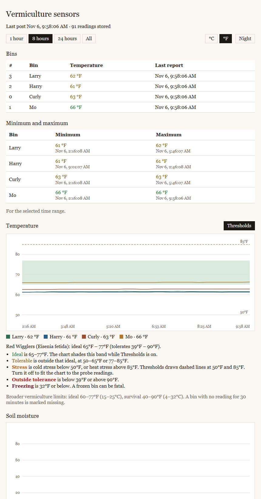

# Vermiculture sensors

The ESP32 reads the temperature probes, serves the chart page, and keeps about 48 hours of readings on the board. It also posts each reading to a Python server on a PC, which appends the long-term log.

The chart in the browser loads history once, then requests the latest reading every minute. The board measures about every 15 minutes.



## Vermiculture

Vermiculture is raising composting worms. The worms eat food scraps and bedding and leave castings, a dense fertilizer. These bins hold red wigglers (*Eisenia fetida*), the usual composting species.

Red wigglers do best between 65 and 77 °F (about 18 to 25 °C). They slow down when the bedding is colder, and they suffer or try to leave the bin when it gets much hotter. Freezing can kill them. Fresh food can also heat a bin from the inside as it breaks down, so a probe in the bedding tells you more than the air temperature does.

Moisture matters about as much. The bedding should feel like a wrung-out sponge. If it's too dry, the worms dry out; if it's too wet, the bin goes anaerobic and sour.

The page shades the ideal temperature band, marks the tolerable and stress ranges, and flags a bin that hasn't reported in 30 minutes.

## Hardware

| Part | Quantity | Purpose |
| --- | --- | --- |
| ESP32 development board (ESP32-WROOM-32, "ESP32 Dev Module") | 1 | Reads the sensors, serves the page, keeps on-board history, posts to the PC |
| DS18B20 waterproof temperature probe | 4 | One probe in each bin's bedding |
| 4.7 kΩ resistor | 1 | Pull-up for the shared temperature data line |
| Capacitive soil-moisture sensor (v1.2 style, analog output) | 1 | Bedding moisture |
| USB data cable and a USB power source | 1 | Uploading and power. A charge-only cable powers the board, but the PC can't see it. |

### ESP32 board

The ESP32 is a 3.3 V microcontroller with built-in Wi-Fi and Bluetooth. The sketch uses Wi-Fi to serve the page and post readings. It also stores readings in the board's flash with LittleFS, which is why the partition scheme in step 3 matters.

Bluetooth is off by default. `BLUETOOTH_KEEPALIVE_ENABLED` in the sketch can pulse it hourly. The pulse was added to keep some power banks from shutting off when the board draws very little current.

### Temperature probes

The DS18B20 is a digital temperature sensor that talks over a 1-Wire bus. Every probe has a unique 64-bit address, so all four share one data pin. The sketch finds them at boot, and the page matches each address to a bin name in `PROBE_NAMES` in `web/index.html`:

| Address | Bin |
| --- | --- |
| `2813f8d500000004` | Larry |
| `284df1d600000042` | Harry |
| `28107bd400000057` | Curly |
| `288201d3000000de` | Mo |

A new or replaced probe shows up in the latest-reading table on the page with its address. Add the address to `PROBE_NAMES` to give it a name.

### Moisture sensor

The capacitive sensor reads moisture through a coated blade, so no bare metal sits in the wet bedding and corrodes. It outputs an analog voltage, which goes up as the bedding dries.

The sketch averages 16 samples and turns the raw 0–4095 reading into a percentage with two calibration values in `vermiculture-sensors.ino`:

- `MOISTURE_DRY_RAW` is the reading with the blade in air (0%).
- `MOISTURE_WET_RAW` is the reading with the blade in water up to its line (100%).

To recalibrate, press the board's EN button with the Serial Monitor open once with the blade in air and once in water, then copy the raw values from the printed readings into the sketch. A reading stuck at 4095 or 0 usually means the signal wire is loose.

More probes can be added to `MOISTURE_PINS`. They have to be on ADC1 pins (32, 33, 34, 35, 36 or 39), because Wi-Fi takes over ADC2.

## Wiring

All sensors run on the board's **3.3 V** pin. Don't power the moisture sensor from 5 V: its output can then go above 3.3 V, which is more than the ESP32's input pins can take.

```
 ESP32                 DS18B20 probes × 4 (wired in parallel)
 ─────                 ──────────────────────────────────────
 3V3  ──┬──────────────  red    VDD   (all four)
        │
      [4.7 kΩ]
        │
 GPIO 4 ┴──────────────  yellow DATA  (all four)
 GND  ─────────────────  black  GND   (all four)

                       Capacitive moisture sensor
                       ──────────────────────────
 3V3  ─────────────────  VCC
 GND  ─────────────────  GND
 GPIO 35 ──────────────  AOUT
```

| From | To | Notes |
| --- | --- | --- |
| Every DS18B20 red (VDD) | 3V3 | |
| Every DS18B20 black (GND) | GND | |
| Every DS18B20 yellow (DATA) | GPIO 4 | Some probes use white or blue for data. |
| 4.7 kΩ resistor | 3V3 and GPIO 4 | One resistor for the whole bus, not one per probe. |
| Moisture VCC | 3V3 | |
| Moisture GND | GND | |
| Moisture AOUT | GPIO 35 | Any ADC1 pin works if `MOISTURE_PINS` matches. |

GPIO 4 is set by `ONE_WIRE_BUS` and GPIO 35 by `MOISTURE_PINS`, both in `vermiculture-sensors.ino`.

If the Serial Monitor prints `Found 0 temperature probes`, check the pull-up resistor and the data wire first. If it finds fewer probes than are connected, look for a loose connection on the missing probe.

## First upload

### 1. Install the Arduino tools

Install the [Arduino IDE](https://www.arduino.cc/en/software) and the **esp32** board package by Espressif, version 3 or newer.

Install these libraries from Library Manager:

- **OneWire** by Paul Stoffregen
- **DallasTemperature** by Miles Burton

Open this repository as the sketch folder. The folder name and `vermiculture-sensors.ino` need to stay matched.

### 2. Fill in secrets

Copy `secrets-example.h` to `secrets.h`. `secrets.h` stays on this machine and is not committed.

Set the Wi-Fi name and password. Leave `SERVER_URL` until the PC server is running; step 4 prints the address to put there.

### 3. Select the board settings

In the Arduino IDE:

- **Board:** ESP32 Dev Module, or the specific ESP32 board you are using
- **Partition Scheme:** Default 4MB with spiffs (1.2MB APP/1.5MB SPIFFS)
- **Port:** the ESP32's serial port

The partition scheme matters. History is stored in the SPIFFS area with LittleFS. A scheme without that area serves the page, but readings disappear when the board restarts.

### 4. Start the PC server and finish secrets

From the `server` directory:

```
python serve.py
```

Python 3 is enough. There is nothing to install with pip.

The window prints two addresses. Open the localhost one to check the PC page. Copy the `ESP32 posts` address into `SERVER_URL` in `secrets.h`. It looks like `http://192.168.x.x:8080/readings`. Leave this window open while the board is posting.

Optional: copy `server/config.example.py` to `server/config.py` and set `GATEWAY` when `8.8.8.8` is not the right route for finding this PC's LAN address.

### 5. Upload

Upload the sketch. Open the Serial Monitor at **115200** baud.

When Wi-Fi connects, the monitor prints the chart address, for example `http://192.168.x.x/` and `http://vermiculture.local/`. Open that address on a phone or computer on the same Wi-Fi.

The board sets its clock from the internet (Pacific time, including daylight saving). It starts storing on-board history after the clock is set. Until then, posts still go to the PC, and the PC stamps the arrival time.

The first boot prints `Started a new reading ring.` Later boots print how many samples are stored.

## When a file changes

| File | What to do |
| --- | --- |
| `vermiculture-sensors.ino` | Upload the sketch again. |
| `sensor_server.cpp`, `sensor_server.h` | Upload the sketch again. |
| `ble_in_use.c` | Upload the sketch again. This file keeps Bluetooth memory reserved. |
| `secrets.h` | Upload the sketch again. |
| `secrets-example.h` | Nothing on the board until those values are copied into `secrets.h` and uploaded. |
| `web/index.html` | From the repository root run `python tools/pack_page.py`, then upload the sketch. The PC server reads this file on each page load, so refresh the browser; do not restart Python for a page-only change. |
| `web_page_gz.h` | Do not edit. `tools/pack_page.py` rewrites it from `web/index.html`. Upload the sketch after it is regenerated. |
| `tools/pack_page.py` | No upload. The next page pack uses the new script. |
| `server/serve.py` | Stop the Python server and start `python serve.py` again from the `server` directory. |
| `server/config.py` | Restart the Python server. |
| `server/config.example.py` | Nothing until it is copied to `server/config.py` and the Python server is restarted. |
| `server/readings.jsonl` | This is the PC archive. Leave it in place. Removing it starts the PC log over. The on-board ring is separate. |
| `README.md`, `docs/dashboard.png` | No upload and no server restart. |

Probe names live in `web/index.html` (`PROBE_NAMES`). Changing them means packing the page and uploading.

Changing the layout of `ReadingSample` in `sensor_server.h` makes the board discard its ring on the next boot and start a new one. The PC log in `readings.jsonl` is left as it is.

The on-board clock zone is `TIME_ZONE` in `sensor_server.cpp`. Changing it requires another upload.
